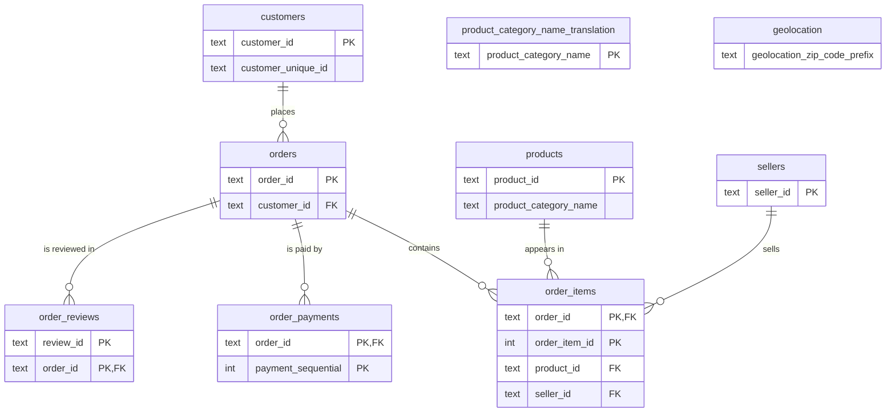

# Olist schema guide

Explored read-only through the `pg-crystaldba-restricted` MCP server. Counts are exact `count(*)` values.

## Overview

The `olist` schema holds the Olist Brazilian e-commerce dataset: customers, orders, order lines, payments, reviews, products and sellers. Orders run from 2016-09-04 to 2018-10-17 (329 in 2016, 45,101 in 2017, 54,011 in 2018). Other schemas are `public` (no lab tables), `pg_catalog` and `information_schema`.

## Tables

| Table | Rows | Primary key | Purpose (inferred) |
|---|---|---|---|
| customers | 99,441 | customer_id | One row per order-time customer record |
| orders | 99,441 | order_id | Order header, status and lifecycle timestamps |
| order_items | 112,650 | (order_id, order_item_id) | Line items: product, seller, price, freight |
| order_payments | 103,886 | (order_id, payment_sequential) | Payment parts per order |
| order_reviews | 100,000 | (review_id, order_id) | Customer review score and comment |
| products | 32,951 | product_id | Product catalog with dimensions |
| sellers | 3,095 | seller_id | Seller location |
| product_category_name_translation | 71 | product_category_name | Portuguese to English category names |
| geolocation | 1,000,163 | none | Zip prefix to lat/lng points |

## Relationships



Not enforced by a foreign key (joined by value only):
- `products.product_category_name` to `product_category_name_translation.product_category_name`
- zip prefixes in `customers`, `sellers` and `geolocation`

Verified cardinality: each `orders.customer_id` appears once (max 1 order per customer_id). Max per order: 21 items, 29 payments, 3 reviews. `orders` to `products` and to `sellers` is many to many through `order_items`.

## Constraints and indexes

CHECK constraints:
- `order_items.price_nonneg`: price >= 0 and freight_value >= 0
- `order_payments.payment_nonneg`: payment_value >= 0
- `order_reviews.review_score_range`: review_score between 1 and 5
- `orders.order_status_valid`: one of created, approved, invoiced, processing, shipped, delivered, unavailable, canceled

Indexes: only the 8 primary key indexes. There are no secondary indexes.

Foreign key columns without a usable index: `orders.customer_id`, `order_items.product_id`, `order_items.seller_id`, `order_reviews.order_id` (second column of its PK only).

## Gotchas

1. **`customer_id` is not a person.** It is created per order. `customer_unique_id` is the real customer.
   `select count(distinct customer_id), count(distinct customer_unique_id) from olist.customers` gives 99,441 vs 96,096. 2,997 people have more than one `customer_id` (max 17).
2. **Joining items and payments inflates money.** Both are one to many from orders.
   `sum(price)` on `order_items` is 13,591,643.70, but after joining `order_payments` it is 14,209,115.34. Aggregate each child table separately first.
3. **`review_id` is not unique.** 100,000 rows but 99,173 distinct `review_id`; 802 ids are reused. The key is (review_id, order_id).
4. **Orders can have no children.** 775 orders have no items and 1 has no payment (`not exists` check against each table).
5. **Delivery date is NULL for most non-delivered orders, and for 8 delivered ones.**
   `select order_status, count(*), count(*) filter (where order_delivered_customer_date is null) from olist.orders group by 1`. 2,965 orders have no delivery date in total.
6. **Category names do not fully join.** 610 products have a NULL category and 13 have a category missing from the translation table.
7. **`geolocation` is not a lookup table.** 1,000,163 rows for only 19,015 distinct zip prefixes, no key. Joining on zip multiplies rows. 278 customers have a zip prefix that is absent from it.
8. **Mostly empty and zero values.** 58,245 reviews have no comment message and 9 payments are 0.
9. **Typo in column names.** `product_name_lenght` and `product_description_lenght` are spelled that way in the data.
10. **Partial years.** 2016 has only 329 orders and 2018 stops on 2018-10-17.

## Useful starter queries

Unique customers who ordered in a month (March 2018 returns 7,115):
```sql
select count(distinct c.customer_unique_id)
from olist.orders o join olist.customers c using (customer_id)
where o.order_purchase_timestamp >= '2018-03-01' and o.order_purchase_timestamp < '2018-04-01';
```

Orders by status:
```sql
select order_status, count(*) from olist.orders group by 1 order by 2 desc limit 10;
```

Revenue per order without fan-out (items only):
```sql
select order_id, sum(price + freight_value) as total
from olist.order_items group by 1 order by 2 desc limit 10;
```
